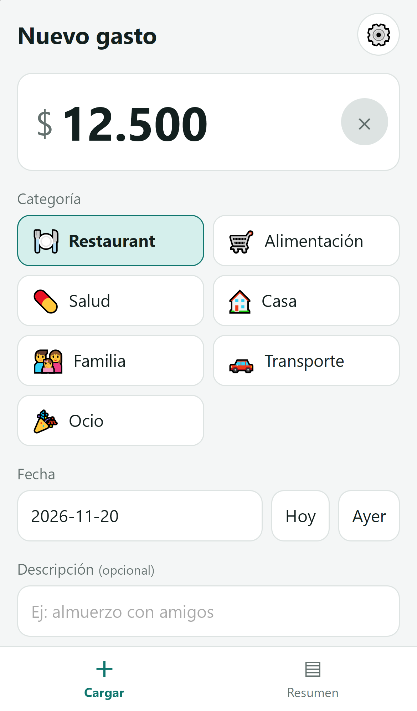
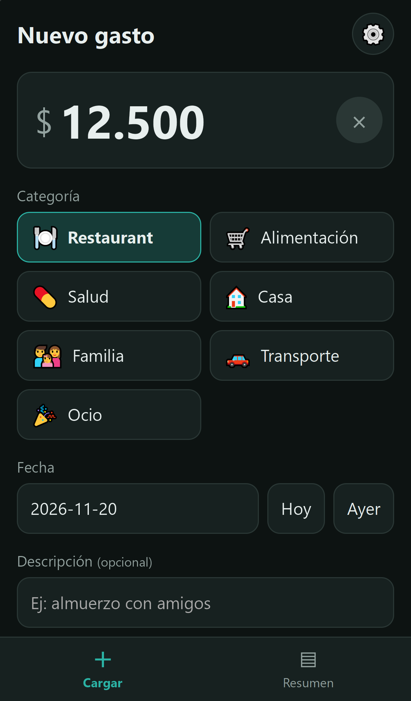

# Historial de versiones

Cada versión publicada tiene una etiqueta en git (`v1`, `v2`, …), una página en
[Releases](https://github.com/joserossi/app-gastos/releases) y capturas en `historial/<versión>/`.
Las capturas usan datos de ejemplo, no gastos reales.

Para recuperar el código de una versión: `git checkout v1` (y `git checkout main` para volver).

---

## v1 · 10 al 20 de noviembre de 2026

Primera versión en uso.

- Carga de gastos con monto, categoría, fecha (hoy, ayer o cualquier día anterior) y descripción opcional.
- Monto con separador de miles mientras se escribe y botón × para borrarlo.
- Siete categorías: Restaurant, Alimentación, Salud, Casa, Familia, Transporte y Ocio, con emojis.
- Resumen del mes: total, barras por categoría con porcentaje y lista de gastos agrupada por día.
- Tocar una categoría del resumen filtra la lista; la × del encabezado quita el filtro.
- Edición y borrado tocando un gasto.
- Uso sin conexión: los gastos quedan pendientes y se suben solos.
- Ícono con el signo $ grande y semitransparente.

| | Cargar | Resumen |
|---|---|---|
| Claro |  |  |
| Oscuro |  |  |
